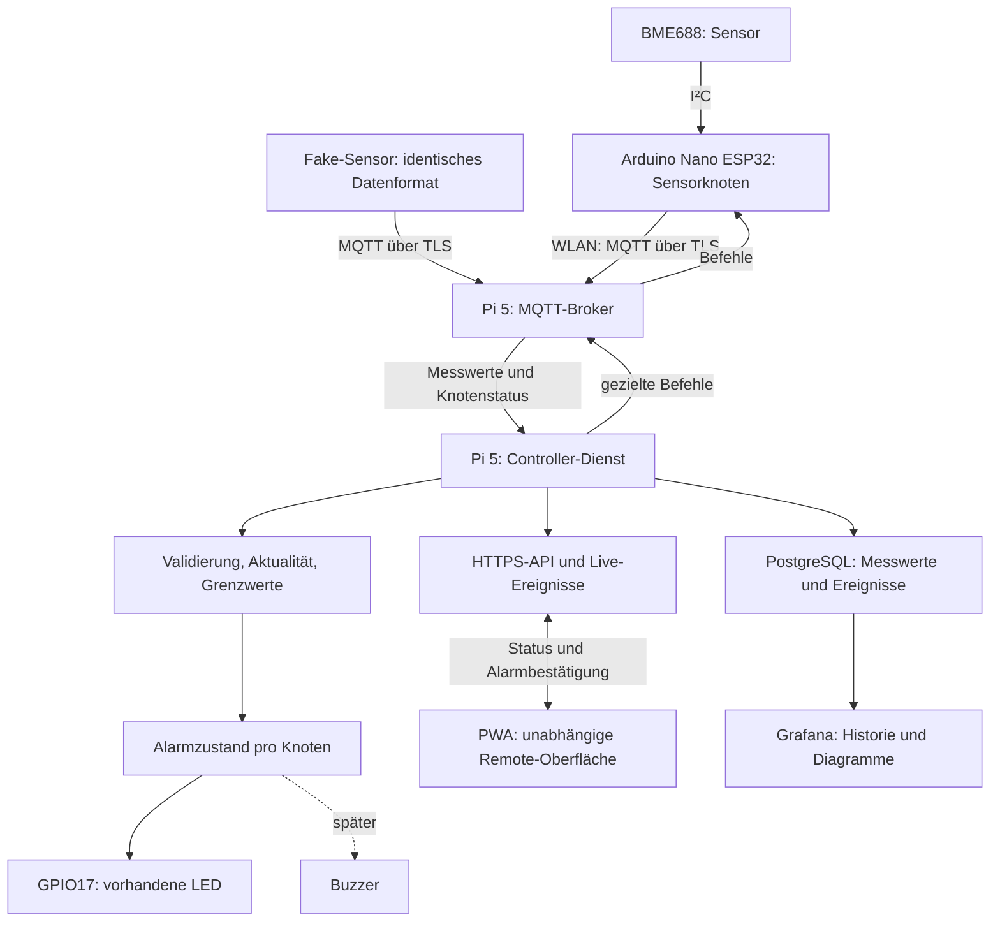

# IoT-Prototyp: Systemarchitektur

Stand: MQTT-Testsender für den Mac und MQTT→PostgreSQL-Empfänger sind implementiert
(siehe [Mac-MQTT-Test](mqtt-mac-test.md)). ESP32-Anbindung, Controller-Alarmlogik und
PWA sind noch nicht implementiert. Vorhanden sind Netzwerk-Scanner, Qt-Oberfläche,
Statistik, PostgreSQL/Grafana-Abgleich und LED-Alarm an GPIO17.

## Gesamtübersicht



Der MQTT-Broker und die fachliche Controller-Logik sind getrennte Module, auch
wenn beide auf dem Pi laufen. Der Browser greift über eine API auf den Controller
zu und erhält keine MQTT-Zugangsdaten der Sensorknoten. Die PWA ist für die lokale
Alarmfunktion nicht erforderlich.

## Module und Verantwortlichkeiten

| Modul | Aufgabe | Austauschbare Umsetzung |
|---|---|---|
| Sensor | Messung und Veröffentlichung | Fake-Sensor, später BME688 am ESP32 |
| Kommunikation | MQTT-Verbindung, Anmeldung, Nachrichten | Gemeinsamer Topic- und JSON-Vertrag |
| Controller | Prüfung, Aktualität, Regeln, Speicherung | Python-Dienst auf dem Pi |
| Aktor | Alarmzustand in Licht/Ton übersetzen | GPIO-LED, später Buzzer |
| Remote | Anzeige und bestätigte Bedienaktionen | HTTPS-API und PWA |

Die lokale Alarmfunktion gehört in den Controller-Dienst, damit sie auch ohne
geöffnete Qt-Oberfläche und ohne Browser funktioniert. Der vorhandene LED-Treiber
ist ein Ausgangspunkt; aktuell steuert die Desktop-GUI die LED. Bei der Umstellung
darf genau ein Prozess die GPIO-Pins besitzen.

## Einheitlicher Nachrichtenvertrag

Vorgeschlagene Topics mit getrennten Berechtigungen je Knoten:

```text
iot/v1/nodes/<node_id>/telemetry   Messwerte vom Knoten
iot/v1/nodes/<node_id>/status      Verbindungsstatus / Last Will
iot/v1/nodes/<node_id>/command     Befehle vom Controller
iot/v1/nodes/<node_id>/ack         Antwort auf einen Befehl
```

Beispiel für Messwerte; Fake-Sensor und ESP32 verwenden dasselbe Schema:

```json
{
  "schema_version": 1,
  "node_id": "lab-01",
  "boot_id": "boot-001",
  "sequence": 42,
  "sent_at": "2026-10-13T10:00:00Z",
  "source": "fake",
  "measurements": {
    "temperature_c": 23.4,
    "humidity_pct": 48.1,
    "pressure_hpa": 1012.3,
    "gas_resistance_ohm": 120000
  }
}
```

Der Controller prüft Schema, Datentypen, Wertebereiche und Übereinstimmung von Topic
und node_id. boot_id und sequence erlauben die Erkennung doppelter Nachrichten bei
QoS 1 und Neustarts. sent_at ist eine ergänzende Sensor-Zeitangabe; Ausfallfristen
werden anhand der lokalen monotonen Empfangszeit berechnet. Retained-Messwerte
belegen keine aktuelle Erreichbarkeit. Ungültige oder doppelte Nachrichten setzen
keine Frist zurück. Der BME688 liefert unter anderem Temperatur, Luftfeuchte,
Luftdruck und Gaswiderstand. Berechnete Luftqualitätswerte werden erst ergänzt,
wenn die entsprechende Auswertung verfügbar ist.

## Erreichbarkeit und Alarme

Für IoT-Knoten wird eine ausbleibende MQTT-Messung statt einer fehlenden
Ping-Antwort überwacht. Ping allein bestätigt nicht die Funktion des Sensors.

Vorgeschlagene Laborwerte: Messung alle 5 Sekunden, Alarm nach 15 Sekunden ohne
neue gültige Messung. Diese Werte sind konfigurierbar und keine garantierten
Echtzeitfristen. Ein Last Will kann einen Verbindungsabbruch melden; ein separater
Fristwächter erkennt einen Knoten, der noch verbunden ist, aber keine Daten liefert.

Getrennte Alarmursachen: Knoten ohne Daten, ungültige Messwerte, Grenzwertverletzung
und Ausfall der Broker-Verbindung. Ein Broker-Ausfall darf nicht als nachgewiesener
Ausfall jedes einzelnen Sensors dargestellt werden. Bei Dienstneustart bleibt ein
Knoten zunächst unbekannt, bis eine neue gültige Nachricht eingetroffen ist.

Grenzwerte erhalten eine Hysterese gegen wiederholtes Ein-/Ausschalten. Alarm
bestätigen und Alarm beenden sind getrennte Aktionen. Die LED zeigt einen weiterhin
aktiven Alarm; eine spätere Bestätigung kann den Buzzer stummschalten. Bei mehreren
Knoten bleibt der gemeinsame Alarm aktiv, bis alle relevanten Ursachen beendet
sind. Befehle bekommen IDs, Ablaufzeiten und Antworten; Schaltbefehle werden nicht
retained veröffentlicht.

## Übertragung und Zugriff

MQTT wird mit TLS, geprüften Serverzertifikaten und individuellen Knoten-Zugängen
betrieben. Topic-Berechtigungen beschränken jeden Knoten auf seine eigenen Daten
und Befehle. WLAN-Verschlüsselung ersetzt diese Absicherung nicht. Zusätzliche
Nachrichtensignaturen sind ein späteres Modul, falls Ende-zu-Ende-Authentizität über
den Broker hinaus erforderlich ist; sie sind kein Ersatz für TLS.

Die Remote-API verwendet HTTPS und Anmeldung. Geheimnisse bleiben außerhalb des
Repositories. Der Prototyp braucht eingerichtete MQTT-Sensorknoten: Anders als der
bisherige Nmap-Scanner kann er nicht allein anhand einer Netzadresse beliebige
Geräte als Sensoren nutzen.

## Umsetzungsschritte

1. Fake-Sensor → MQTT-Broker → Controller: Nachrichten validieren, speichern und
   ausbleibende Daten erkennen; Normalbetrieb und Ausfall reproduzierbar testen.
2. LED-Alarm in den Controller übernehmen; Sensor-Ausfall, Wiederverbindung,
   Broker-Ausfall und mehrere gleichzeitig alarmierende Knoten testen.
3. API und PWA: Knotenübersicht, Messwertverlauf, Regeln und Alarmbestätigung.
4. BME688 am ESP32 einbinden und denselben Nachrichtenvertrag verwenden.
5. Buzzer und weitere Aktoren ergänzen.

Nmap bleibt bei Bedarf ein separates Diagnosemodul. Die bisherige PostgreSQL-
Struktur enthält Netzwerkdaten; IoT-Knoten, Messwerte und Alarmereignisse brauchen
zusätzliche Tabellen. Für den MQTT-Verlauf sind neue Grafana-Abfragen nötig.

## Quellen

- [MQTT: Funktionsumfang und Sicherheit](https://mqtt.org/faq/)
- [Bosch: BME688 und Messgrößen](https://www.bosch-sensortec.com/en/products/environmental-sensors/gas-sensors/bme688)
